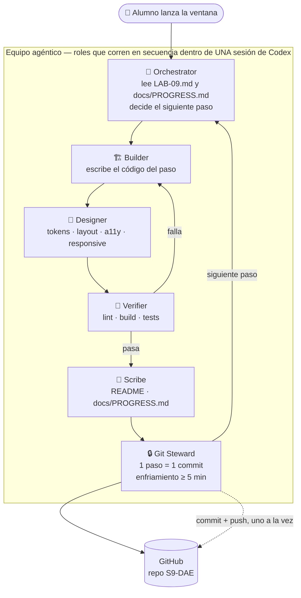
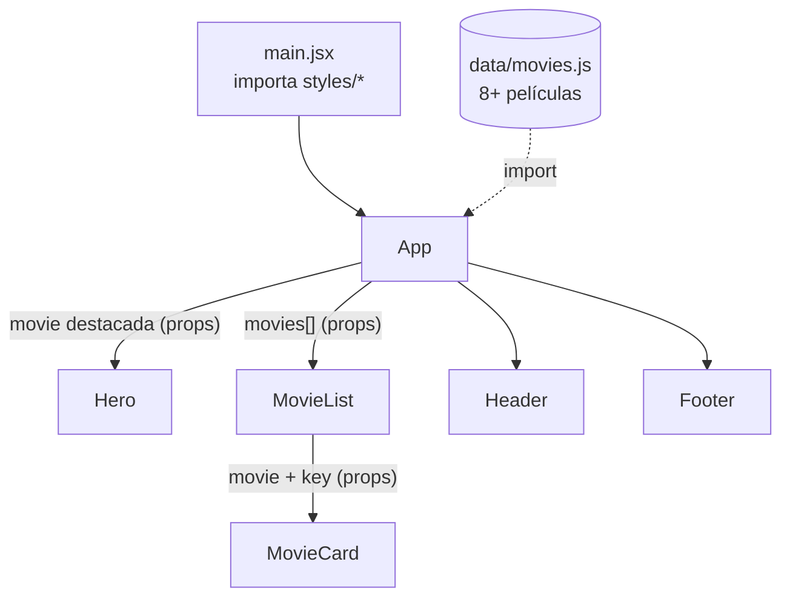

# LAB 09 ReactJS

Objetivo: construir desde cero la cartelera estática Aurora Cinemas con React y Vite.
Capacidades: crear y ejecutar el proyecto, componer componentes funcionales y pasar datos mediante props.
Rama de trabajo: `main`.

## Estructura agéntica



```text
 ┌────────────────────── BUCLE POR PASO (se repite 1 vez por paso) ──────────────────────┐
 │                                                                                        │
 │  [1 PLAN]──►[2 BUILD]──►[3 DESIGN]──►[4 VERIFY]──►[5 NOTES   ]──►[6 GATE]──►[7 COMMIT] │
 │     ▲            ▲                        │                          │           │     │
 │     │            └────── falla ──────────┘                          │           ▼     │
 │     │                                                     < 5 min desde el   [8 PUSH]  │
 │     │                                                     último commit?          │    │
 │     │                                                     sí → espera/pule        ▼    │
 │     └───────────────────────── [9 MENSAJE DE ESTADO + PROGRESS.md] ◄──────────────┘    │
 └────────────────────────────────────────────────────────────────────────────────────────┘
```

## Arquitectura objetivo



## Árbol actual

```text
S9-DAE/
├── AGENTS.md · README.md
├── docs/PROGRESS.md
└── cinema-app/
    ├── index.html · package.json · package-lock.json · vite.config.js
    ├── README.md
    ├── public/favicon.svg · public/posters/ (8 pósters SVG)
    └── src/
        ├── main.jsx · App.jsx
        ├── data/movies.js · movies.test.js
        ├── test/setup.js
        ├── styles/ (tokens · base · layout · utilities)
        └── components/
            ├── Header/ · Footer/ · Hero/
            └── MovieCard/ · MovieList/ (MovieList.test.jsx)
```

## Comandos

Desde `cinema-app/`: `npm install`, `npm run dev`, `npm run lint`, `npm run build` y `npm test`. Versiones instaladas en este entorno: Node.js 24.19.0, npm 11.17.0, React 19.3.1 y Vite 8.3.8.

## Reglas de Git y diseño

- Un paso verificado por commit; espera al menos 5 minutos entre commits y limita a 12 por hora.
- Mensajes Conventional Commits en inglés con pie `Lab: 09 | Step: NN/12`; push secuencial a `origin main` solo después de autorización del alumno.
- Identidad Git existente; no reescribir historia ni publicar código roto.
- React: PascalCase, una carpeta por componente, props explícitas y CSS BEM adyacente.
- Aurora Cinemas: tema noir cálido, tokens CSS centralizados, fuentes Fraunces e Instrument Sans, diseños adaptables y accesibles.

## Definición de terminado

Pasos 01–12 registrados con hash en `docs/PROGRESS.md`; lint, build y pruebas en verde; este archivo actualizado con árbol y arquitectura reales; README con instalación y uso; cambios publicados en `origin` o commits locales documentados.
